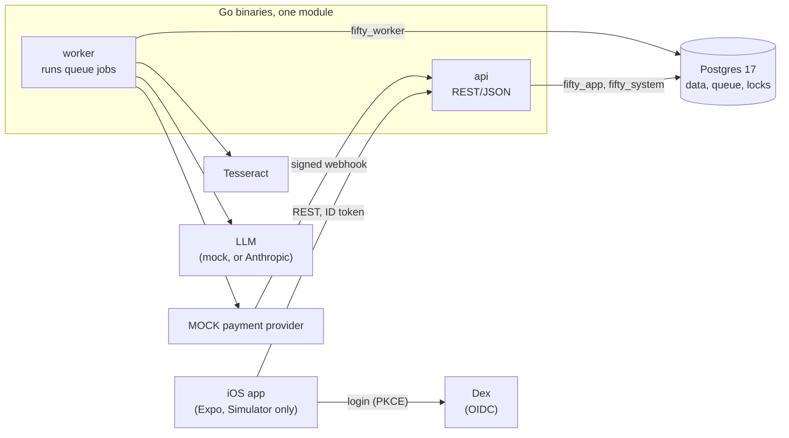

# Fifty Fifty

Split a bill with friends: photograph the receipt, a language model reads the items, everyone claims what they ate, and the app keeps net balances and settles up.

**Go · PostgreSQL 17 · sqlc + pgx · OpenAPI · OIDC (Dex) · React Native / Expo (TypeScript) · Tesseract OCR · Anthropic API · Docker · GitHub Actions**

A backend-heavy portfolio project by Ryan Yap. The app is the excuse; the work is in how it is built and how hard it was tested. **Settlement is simulated** (the payment provider is a mock, no money moves) and all data is synthetic. Every number below comes from a recorded run, listed with its method and its limits in [docs/EVIDENCE.md](docs/EVIDENCE.md).

## What it demonstrates

- **Money you can trust.** An append-only double-entry ledger in integer cents, whose rules (every posting sums to zero, nothing is edited or deleted) the *database* enforces, not just the application.
- **Correctness under concurrency.** Many people claim items on one bill at once. Row locks keep it consistent, and a stress test proves it: 3 runs of 24 simulated users for 60 s, about 10,000 expenses and 1,200 settlements each, **0 violations of 11 invariants**. The same test with one lock switched off in a never-shipped build shows what each lock prevents (with the finalize lock off: 2,209 / 2,355 / 2,211 violations).
- **Background jobs that survive crashes.** A job queue built on Postgres (`SKIP LOCKED`, leases, fencing tokens, retries with backoff). `kill -9` of a worker mid-job, 40 trials and 960 jobs: **0 lost, 0 duplicated**.
- **Payments that survive failures.** Idempotent settlement against a flaky provider that loses responses, sends duplicate and reordered webhooks and gets a worker killed: 4,500 settlements, **0 anomalies**.
- **Security in layers.** OIDC login (Auth Code + PKCE), a cross-group authorization test suite (4 kinds of actor x 41 scenarios), Postgres row-level security, and least-privilege database roles. Writing the login test found that the identity provider was not enforcing PKCE; it is now.
- **An AI model treated as untrusted.** Its answer must match a strict schema, arithmetic decides whether a person checks it, and card numbers, emails and phone numbers are redacted before text leaves. Measured with a real model on 50 synthetic receipts in 5 noise levels: the check **caught 43 of 46 wrong-amount receipts and none of 8 quantity errors**, and the 3 amount errors that got through were all the model quietly filling in an unreadable price. Ten prompt-injection attacks were all ignored; that is a result, not a claim of resistance.
- **A real client.** An iOS app (React Native, Expo) for the whole flow, typed from the OpenAPI spec.

## Try it

Needs Docker, Go 1.27+ and Tesseract (`brew install tesseract`). Developed on macOS (Apple Silicon); not tried on Linux or Windows.

    git clone https://github.com/riyne/fifty-fifty && cd fifty-fifty
    make demo

One command starts Postgres and Dex in Docker, builds the real api and worker, makes a throwaway database, and walks through the whole product over HTTP as three people signed in through a real OIDC provider, with a mock language model and a mock payment provider. After the first run (which builds the Dex image and pulls Postgres) it takes about 15 seconds, and it exits non-zero if any check fails. Abridged output:

    == 2. Receipts: upload, OCR, redaction, mock LLM, validation (a worker is killed on purpose)
    worker-1 killed with SIGKILL while its jobs were waiting on the model (no chance to clean up)
    worker-2 started; it takes the jobs over when worker-1's leases (3 s) expire
    expense 6eeaa4a5  claiming     14 items  total 378.11 CAD  (ground truth of receipt 1: same total and 14 units, each once)
    database: 5 receipt.parse jobs took 8 attempts in total; the extra attempts are the killed worker's jobs run again ...

    == 3. Claim items, finalize (idempotent), the ledger
    alice finalized "Receipt" (total 378.11): ledger transaction c0c13a27
        the same request sent again with the same Idempotency-Key: replayed=true, same ledger transaction=true
    balances after the finalizes:
        alice     147.89
        bob        14.88
        carol    -162.77
        sum of balances: 0 (always 0)

    == 4. Settle up through the MOCK payment provider (simulated; webhooks duplicated and delayed)
    carol pays alice 147.89 CAD: settlement 0e181075 created `pending`, a settlement.execute job queued in the same transaction
    settlement is `succeeded`

    == 5. Checks (recomputed from the tables and the provider's own record, not from API answers)
    sum of every ledger entry: 0 (must be 0)
    settlements 1, by status map[succeeded:1]: ledger postings 1, provider charges 1, anomalies 0

### The iOS app

Needs macOS with Xcode, Node and CocoaPods (`brew install cocoapods`). In one terminal, start the backend and leave it running (stop `make run-api` first: both use port 8080):

    make demo-keep

In another:

    cd mobile && npm install
    npx expo run:ios        # builds the app, starts Metro, opens the iOS Simulator

Sign in as `alice`, `bob` or `carol` (password `password`). To add a receipt, put an image in the Simulator's photo library with `xcrun simctl addmedia booted <image>`; `make demo-keep` prints the path of the synthetic receipts it made. Only those parse into items, because the mock model answers from the receipt's reference line.

<table>
  <tr>
    <td align="center"></td>
    <td align="center"></td>
    <td align="center"></td>
    <td align="center"></td>
  </tr>
  <tr>
    <td align="center">Balances and a suggested transfer</td>
    <td align="center">A finalized expense and its claims</td>
    <td align="center">A receipt read into items</td>
    <td align="center">A simulated settlement</td>
  </tr>
</table>

Screenshots from the iOS Simulator against `make demo-keep`: synthetic data, the mock model, a simulated settlement.

## How it fits together

The api and the worker never talk to each other: they meet in Postgres, which is the database, the job queue and the lock manager. [docs/ARCHITECTURE.md](docs/ARCHITECTURE.md) has the rest: the database roles, an ER diagram, the flows for a request, the ledger, the queue, receipts and settlement, the design choices, and a reading guide for the queue, locking, idempotency and the ledger.

## Where to look in the code

| If you want to see... | Read |
|---|---|
| claims, finalize and void; the row locks | `internal/expenses` |
| idempotency (`Idempotency-Key`, inside the transaction) | `internal/idempotency` |
| exact bill splitting; the ledger | `internal/allocator`, `internal/ledger`, `migrations/00005_ledger_core.sql` |
| the Postgres job queue and the worker | `internal/queue`, `internal/worker` |
| settlement, with one function that moves its state | `internal/settlements` (`Resolve`) |
| row-level security and the database roles | `internal/dbscope`, `migrations/00015` to `00017` |
| the receipt pipeline and the untrusted model | `internal/receipts`, `internal/receiptparse`, `internal/anthropic` |
| the stress test and the switched-off protections | `internal/harness/stressrig`, `internal/controls`, `bench/stress` |
| tests that attack it | `test/bola`, `test/rls`, `test/dbinvariants`, `test/e2e` |
| the benchmarks and their raw results | `bench/`, `bench/results/` |
| the iOS app | `mobile/` |

## Development

    make up && make migrate-up   # Postgres (localhost:5433) and Dex (localhost:5556), then the schema
    make test                    # unit and integration tests (need the database above)
    make test-e2e                # real worker and mock-provider processes, a killed worker (about 2 minutes)
    make ci                      # what CI runs, about 6 minutes
    make run-api                 # the api on :8080 against the development database
    TOKEN=$(scripts/dev-token.sh alice)     # a real Dex token for alice, bob or carol
    curl -H "Authorization: Bearer $TOKEN" localhost:8080/v1/me
    make generate                # regenerate the sqlc code after editing migrations/ or internal/db/queries/
    make mobile-check            # the app's typecheck, generated-types check and Jest tests

The database and Dex credentials in `deploy/` and the Makefile (`fifty`, `password`) are throwaway values for local development only, and all data is synthetic.

Tests skip silently when the database variables are unset (the Makefile sets them; CI makes a missing database a failure). Stop any `worker`, `mockllm`, `mockpay` or api left running before `make test`: a worker on the development database claims the tests' jobs and breaks them. Benchmarks are described in [bench/README.md](bench/README.md); `make bench-accuracy` calls the real Anthropic API and **costs money**.

CI (GitHub Actions) runs gofmt, vet, golangci-lint, a check that generated code is current, the tests against a real Postgres, Tesseract and Dex, `govulncheck`, a gitleaks scan of the history, and the app's typecheck and Jest tests. The end-to-end tests, negative controls and benchmarks are run by hand.

## What this is not

- **Not a payments product.** No real money, no real provider. Debt simplification is a greedy heuristic that reduces transfers and does not minimize them.
- **Synthetic data only.** The receipts, the redaction patterns and the prompt were written by one author in one clean layout, so results on them flatter the system. Nothing here says how it does on real receipts or photographs.
- **No load figures.** The stress and queue runs share one laptop; they show correctness under contention and the shape of the queue, not capacity.
- **Not shown to be secure.** Tested, with limits: row-level security covers membership of the group on the user path only, and the worker, the webhook and first login run as other roles.
- **Android, a physical device and the camera** were never run; the app was driven by hand on the iOS Simulator.

## Future work

Not built, and not claimed. The reasons and designs are in [ARCHITECTURE.md section 10](docs/ARCHITECTURE.md#10-known-limits-and-future-work).

- **Re-record the benchmarks that predate row-level security** (negative controls, settlement, queue retries), which would remove the "recorded before" caveats from [EVIDENCE.md](docs/EVIDENCE.md).
- **Cut the identity seam's cost.** Row-level security's per-read round trips cost about half the throughput of a local mixed workload; a pipelined read is designed and not built.
- **A third prompt** that stops the model working out unreadable prices without making it drop the total (needs fresh receipts).
- **The app:** an automated UI test, creating an expense without a receipt, Android, the camera.
- **Beyond a laptop:** a real payment provider, more than one api instance, an object store for receipt images, a container image.

License: [MIT](LICENSE).
