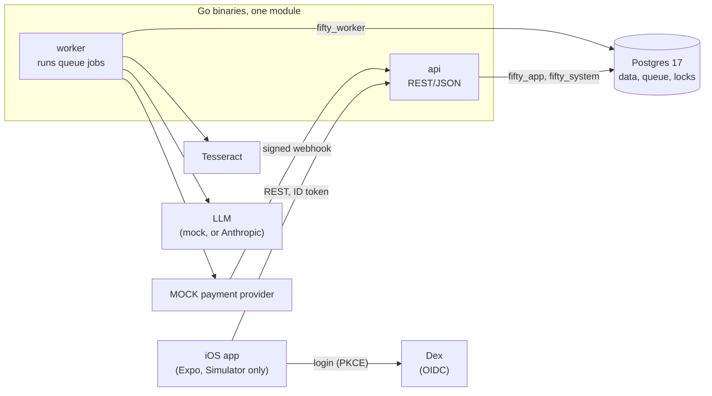
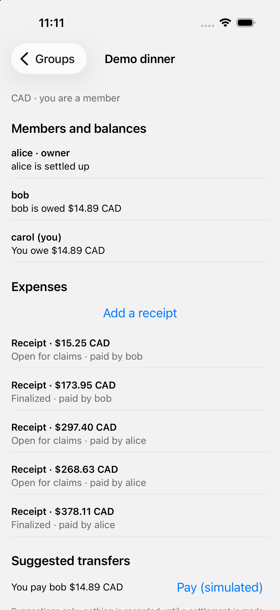
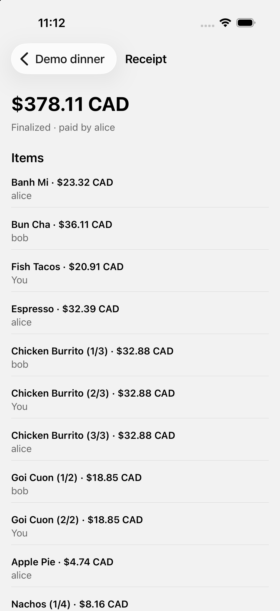
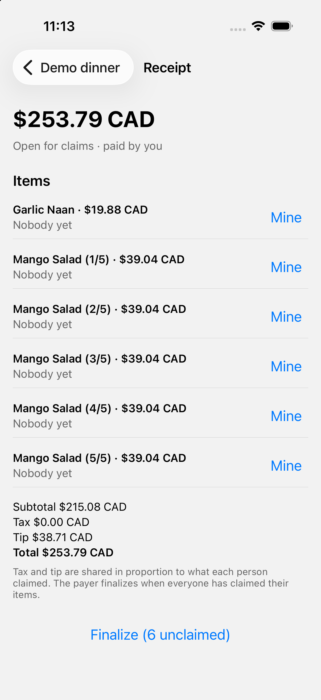
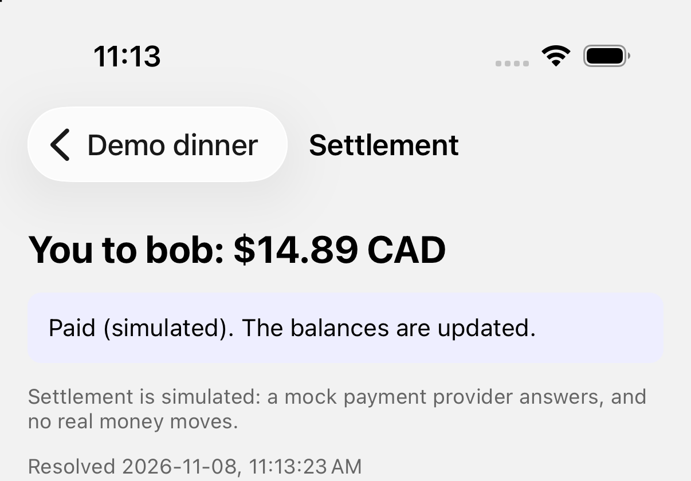

# Fifty Fifty

Split a bill with friends: photograph the receipt, a language model reads the items, everyone claims what they ate, and the app keeps net balances and settles up.

> **What this is.** A backend-heavy portfolio project by Ryan Yap. The app is the excuse; the work is in how it is built and how hard it was tested: correctness under concurrency, a job queue that survives crashes, idempotent payments against a flaky provider, authorization, and an LLM treated as an untrusted dependency. Every number on this page comes from a recorded run and has a row in [docs/CLAIMS.md](docs/CLAIMS.md) with its method and its limits.
>
> **What it is not.** **Settlement is simulated**: the payment provider is a mock and no money moves. All data is synthetic. The ledger records IOUs between friends, not funds. The real language-model API was used in one evaluation and a smoke test; everything else (tests, demo, mobile) runs against a mock model. See [What this is not](#what-this-is-not).

## Try it

Needs Go 1.27+, Docker and Tesseract (`brew install tesseract`). Developed and run on macOS (Apple Silicon); nothing here has been tried on Linux or Windows.

    make demo

One command builds the real api and worker, makes a fresh throwaway database, starts them with a mock LLM and a mock payment provider, and walks through the whole product over HTTP as three people signed in through a real OIDC provider. Output (abridged):

    == 2. Receipts: upload, OCR, redaction, mock LLM, validation (a worker is killed on purpose)
    worker-1 killed with SIGKILL while its jobs were waiting on the model (no chance to clean up)
    worker-2 started; it takes the jobs over when worker-1's leases (3 s) expire
    expense 2a055f01  claiming     14 items  total 378.11 CAD  (ground truth of receipt 1: same total and 14 units, each once)
    database: 5 receipt.parse jobs took 8 attempts in total; the extra attempts are the killed worker's jobs run again ...

    == 3. Claim items, finalize (idempotent), the ledger
    alice finalized "Receipt" (total 378.11): ledger transaction d7b62409
        the same request sent again with the same Idempotency-Key: replayed=true, same ledger transaction=true
    balances after the finalizes:
        alice     147.89
        bob        14.88
        carol    -162.77
        sum of balances: 0 (always 0)

    == 4. Settle up through the MOCK payment provider (simulated; webhooks duplicated and delayed)
    carol pays alice 147.89 CAD: settlement 0b7c4b87 created `pending`, a settlement.execute job queued in the same transaction
    settlement is `succeeded`

    == 5. Checks (recomputed from the tables and the provider's own record, not from API answers)
    sum of every ledger entry: 0 (must be 0)
    settlements 1, by status map[succeeded:1]: ledger postings 1, provider charges 1, anomalies 0

`make demo-keep` leaves the stack running so the [iOS app](#running-the-ios-app) can use it (stop `make run-api` first: both want port 8080).

## How it fits together

The api and the worker never talk to each other: they meet in Postgres, which is the database, the job queue and the lock manager. Three database roles with different privileges, row-level security on the user path, and a ledger whose rules the database enforces itself. [docs/ARCHITECTURE.md](docs/ARCHITECTURE.md) has the full picture: the processes, how the database is set up and why there are four roles, an ER diagram, and the flows for a request, the ledger, the queue, receipts and settlement.

## What was built, and the evidence

Numbers are from one machine (Apple M3 Pro, Postgres 17 in Docker Desktop, everything sharing the laptop), with a mock LLM or a mock payment provider where the text says so. They show what happened in those runs, not what a deployment would do.

### A ledger that stays correct under concurrent use
Expenses are claimed item by item, finalized into an append-only double-entry ledger, and can be voided. Claims share a row lock, finalize and void take it exclusively, and an edit uses an optimistic version; every mutating request carries an `Idempotency-Key`. The database itself enforces that each posting sums to zero, that the ledger cannot be updated or deleted, and that rows cannot cross groups.
- **Stress run through the real api, three recorded runs of the production build:** 24 users in 4 groups acting for 60 s with retries, duplicate keys, abandoned requests and barrier-released races, plus settlement rounds executed by real worker processes. About 10,000 expenses and 1,200 settlements per run. **0 violations of any of 11 invariants and 0 server errors in all three**, checked by recomputing from the tables, never from API answers; and the run proves the dangerous things happened (for example, in about 2,000 race rounds per run, two edits made from one version met, one applied and one was refused). CLAIMS row 1.
- **Negative controls:** the same run with one protection switched off, in a separate build that is never shipped. With the claim lock off the ledger disagreed with the claims in every run; with the finalize lock off, 2,209 / 2,355 / 2,211 violations; with the idempotency check off, 5,761 / 6,411 / 5,555 duplicate expenses or settlements. Some locks showed no violation because another layer caught it, and the report says which layer. CLAIMS rows 2 and 21.
- Not shown: throughput or latency (everything shares one laptop, so none is claimed).

### A job queue that survives a worker being killed
A Postgres table, `FOR UPDATE SKIP LOCKED` claims, leases with heartbeats, fencing tokens so a worker that lost its lease cannot overwrite the new attempt, jittered backoff, a dead-letter state. Handler effects and job completion commit in one transaction, so effects in Postgres are exactly-once; calls to the model or the provider are at-least-once, and the code says so.
- **`kill -9` of one of three workers mid-job, 40 trials, 960 jobs: 0 lost, 0 duplicate effects.** Recovery per orphaned job: median 3.76 s with a 3 s lease and 10.81 s with a 10 s lease (it is set by the lease). CLAIMS row 5.
- **Throughput against a mock LLM with simulated latency of 800 ms:** 4.4 / 8.9 / 17.8 / 35.9 jobs/s at 1 / 2 / 4 / 8 workers (4 jobs in flight each), 96 to 97% of the slots-over-latency bound, with 0 duplicate or missing effects. CLAIMS row 4.
- Not shown: a real LLM, other machines, a larger jobs table.

### Idempotent settlement against a flaky provider (simulated)
One function, `settlements.Resolve`, is the only code that moves a settlement forward and posts it to the ledger; the execute job, the reconcile job and the webhook all call it. A timeout after the provider charged becomes `unknown` and is reconciled; duplicate, delayed and reordered webhooks are harmless.
- **4,500 settlements in 15 runs under five fault mixes** (lost responses, requests that never arrive, declines, failed reads, webhooks duplicated, dropped and reordered, a worker killed with SIGKILL), against a mock payment provider with simulated latency of 300 ms: **0 anomalies**; succeeded settlements = ledger postings = provider charges, and nothing was charged but recorded failed. CLAIMS row 19.
- Not shown: a real provider. The time an unclear settlement takes to resolve is set by placeholder constants in the reconcile schedule, not by the design.

### Authorization, in the application and in the database
OIDC login against Dex (Auth Code + PKCE), group-scoped authorization, and a cross-group (BOLA) test suite: 4 kinds of actor across 41 scenarios, which also fails if a new endpoint has no scenario. Row-level security backs it up in Postgres: the application role sees only the rows of the caller's groups even for a query that forgot its own check. A detector test weakens the policies 29 ways, one at a time, and requires the tests to notice each.
- **Cost, measured at the database layer:** the policies cost about 18% of a mixed read and write workload's throughput and the identity seam that supplies the caller cost about half of it, mostly from extra round trips on a local database. CLAIMS rows 7 and 11.
- Not shown: that the system is "secure". RLS covers membership of the group on the user path only; the worker, the webhook and first login run as other roles, and the caller's identity is a transaction setting that code running as the application role could set to anyone.

### An LLM as an untrusted dependency
A receipt is read by Tesseract, stripped of card numbers, emails and phone numbers by regular expressions, and sent to the model, whose answer must match a strict schema; whether a person has to look is decided by arithmetic alone (items + tax + tip must equal the printed total). The model is behind an interface and mockable, errors never quote the service or the receipt, and a crashed worker mid-call leaves nothing half done.
- **Redaction recall on synthetic receipts:** 100% on perfect text, 96.1% on Tesseract's reading of clean renders, 72.7% at the harshest noise; emails are the weak spot. CLAIMS row 9.
- **Accuracy with a real model (Claude Haiku 5.5), 50 synthetic receipts in each of five variants:** prices right on all 50 for perfect text and for a clean render, then 80%, 76% and 34% as synthetic noise grows, mostly because Tesseract garbles the text. **The arithmetic review flag caught 43 of the 46 wrong-amount receipts and none of the 8 with a wrong quantity (arithmetic cannot see those). Three wrong amounts got through, and all three are the model filling an unreadable price so that the sum matches the printed total**, which defeats the check. That is a finding about this design, kept in the open: DESIGN section 13 has the follow-up. About 8 US cents for the 250 calls. CLAIMS row 10.
- Not shown: real receipts or photographs, any resistance to prompt injection (no injected receipt was sent), a general catch rate for the flag.

### The iOS app
A React Native (Expo) client for the whole flow against the unchanged api: sign in, groups and join codes, expenses with claim, finalize and void, add a receipt from the photo library, review and confirm, and a simulated settlement followed to a final state. Typed from `api/openapi.yaml` with a drift check, and its pure logic has Jest tests. **Run by hand on the iOS Simulator only**: no Android, no physical device, no camera, no automated UI tests, not in CI. CLAIMS row 12.

<table>
  <tr>
    <td align="center"></td>
    <td align="center"></td>
    <td align="center"></td>
    <td align="center"></td>
  </tr>
  <tr>
    <td align="center">Balances and a suggested transfer</td>
    <td align="center">A finalized expense and its claims</td>
    <td align="center">A receipt read into items</td>
    <td align="center">A simulated settlement</td>
  </tr>
</table>

Screenshots from the iOS Simulator against `make demo-keep`: synthetic data, the mock LLM (the receipt in the third is a synthetic one from `cmd/receiptgen`), and a simulated settlement.

## Decisions worth a look

- **A Postgres queue, not Kafka, SQS or River.** Transactional enqueue with no extra infrastructure, and the mechanism is the point. The cost is stated: it will not carry very high job rates, and workers poll.
- **READ COMMITTED with targeted row locks, not SERIALIZABLE.** Claimers must not block each other; finalize must see a stable set of claims. The lock strengths and why are in [ARCHITECTURE section 8.2](docs/ARCHITECTURE.md#82-locking).
- **Idempotency inside the transaction.** The key row, the operation's writes and the stored response commit or roll back together, so there is no "in progress" state to get stuck on.
- **One writer for settlement state**, and invariants the database enforces itself, so a bug in the application cannot corrupt the ledger.
- **Every protection that matters can be switched off, in a build that is never shipped**, so a clean run can be told apart from a run that could not have failed.
- **The model's answer is untrusted** and a person confirms; there is no "confidence" field to be fooled by.
- Every decision, with its reasons and its commit, is in the log in [docs/DESIGN.md](docs/DESIGN.md) section 2.

## What this is not

- **Not a payments product.** No real money, no real provider; "production use", "banking-grade" and "payments platform" would all be false. Debt simplification is a greedy heuristic that reduces transfers; it does not minimize them.
- **Synthetic data only**, and the receipts, the redaction patterns and the prompt were written by one author in one clean layout, so results on them flatter the system. Nothing here says how it does on real receipts.
- **No load figures.** The stress and queue runs share one laptop; they show correctness under contention and the shape of the queue, not capacity.
- **Not shown to be secure.** Tested, with the limits above; the login flow has no automated test (CLAIMS row 6 stays `planned`).
- **CI** (gofmt, vet for both builds, a check that the generated code is current, tests against a real Postgres and Tesseract, a vulnerability scan) ran green on GitHub on 2026-11-07. The end-to-end tests, the negative controls and the benchmarks are not run in CI, and there is no lint or secret scanning.
- Known smaller limits: the rate limiter is in one process's memory; receipt images live in a directory on one host with no deletion; the payment webhook exists only when a signing secret is set. The full list of what may and may not be claimed is at the bottom of [docs/CLAIMS.md](docs/CLAIMS.md).

## Development

    make up && make migrate-up   # Postgres (localhost:5433) and Dex (localhost:5556), then the schema
    make test                    # unit and integration tests (need the database above)
    make test-e2e                # real processes on scratch databases: settlement, the receipt pipeline with a killed worker (about 2 minutes)
    make test-unsafe             # the negative-control seams, and the suite once with the unsafe_controls tag
    make test-controls           # the negative controls at smoke size: real processes, about 6 minutes
    make ci                      # what CI runs, about 5.5 minutes
    make run-api                 # the api on :8080 against the development database
    TOKEN=$(scripts/dev-token.sh alice)     # a real Dex token for alice, bob or carol (password "password")
    curl -H "Authorization: Bearer $TOKEN" localhost:8080/v1/me
    make generate                # regenerate the sqlc code after editing migrations/ or internal/db/queries/

Benchmarks (each needs a clean git tree; method in [bench/README.md](bench/README.md), raw results in `bench/results/`): `make bench-queue bench-recovery bench-settlement bench-stress bench-redaction bench-rls`. `make bench-accuracy` calls the real Anthropic API and **costs money** (about 8 US cents); it needs `ANTHROPIC_API_KEY` in the shell and refuses to start unless the call count is confirmed.

Layout: `cmd/` the binaries (`api`, `worker`, `demo`, and the mocks `mockllm` and `mockpay`), `internal/` the packages (the ledger, queue, settlement, receipts, row-level-security seam, and the stress and settlement rigs), `migrations/` the 16 migrations, `api/openapi.yaml` the contract, `test/` the cross-package suites (BOLA, row-level security, database invariants, end to end), `bench/` the benchmarks, `mobile/` the app. The full map is in [DESIGN section 3](docs/DESIGN.md#3-architecture).

### Running the iOS app

Needs macOS with Xcode, Node and CocoaPods (`brew install cocoapods`). Start the backend with `make demo-keep`, then:

    cd mobile && npm install
    npx expo run:ios           # builds the development build (scheme fiftyfifty://), starts Metro, opens the simulator
    make mobile-check          # typecheck, the generated-types drift check, Jest (not part of make ci)

Sign in as alice, bob or carol (password `password`). To add a receipt, put an image in the simulator's photo library with `xcrun simctl addmedia booted <image>`; `make demo-keep` prints the path of the synthetic receipts it made. Only receipts from `cmd/receiptgen` parse into items, because the mock model answers from the receipt's reference line; any other image goes to review.

## Not built

Kubernetes, Terraform and autoscaling; multi-currency; envelope encryption of receipts; push notifications; Android; a container image for the api and worker. The path from here: containerize the api and worker, put an object store behind `internal/objstore.Store` in place of the shared directory, and move the rate limiter out of process memory.

## Docs

- [docs/ARCHITECTURE.md](docs/ARCHITECTURE.md): how it fits together, the database, and a guide to the four things to be able to explain (the queue, locking, idempotency, the ledger).
- [docs/DESIGN.md](docs/DESIGN.md): the design and the decision log, one row per decision with its commit; open items in section 13.
- [docs/CLAIMS.md](docs/CLAIMS.md): every claim, its evidence, its method, and what must not be claimed.
- [bench/README.md](bench/README.md): how each benchmark works and what it does not show.

License: not yet chosen (the repository is private).
