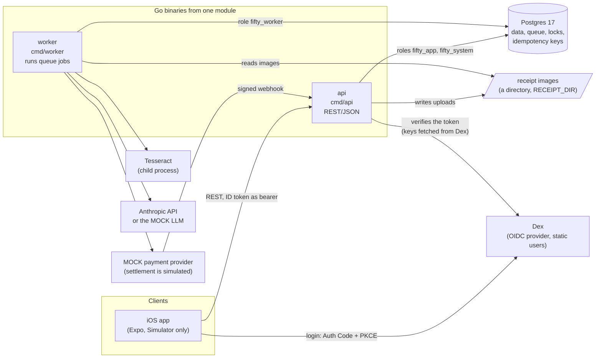
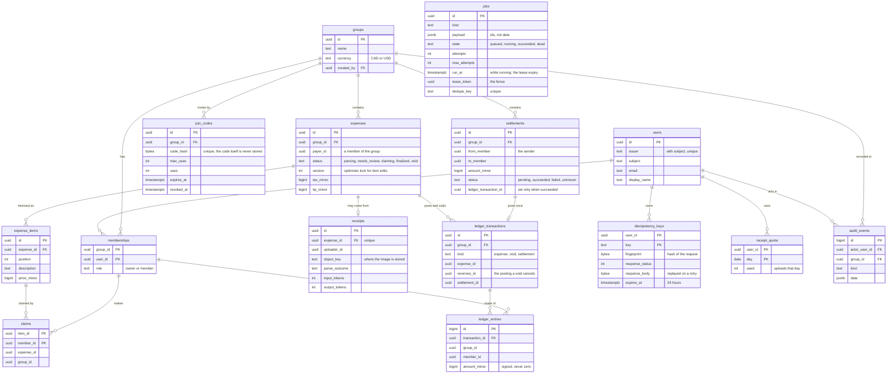
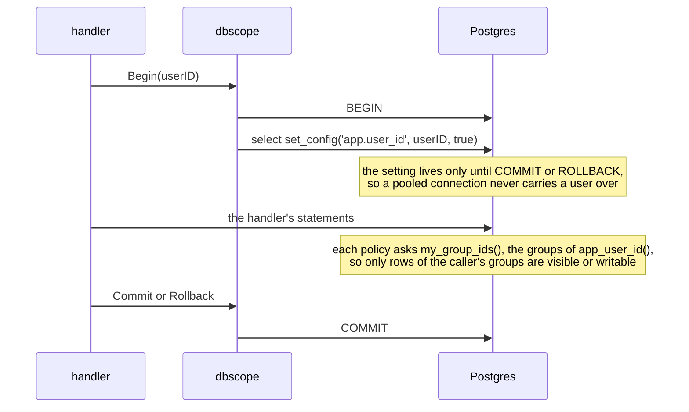
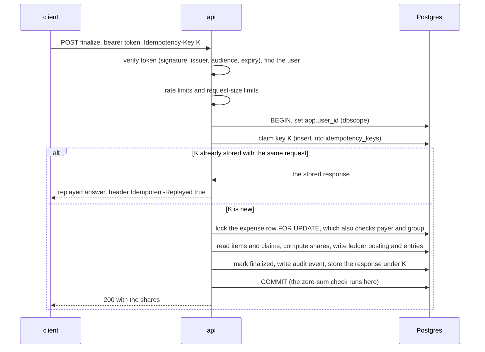
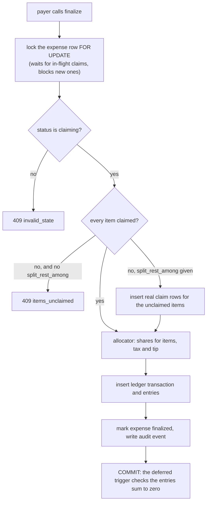
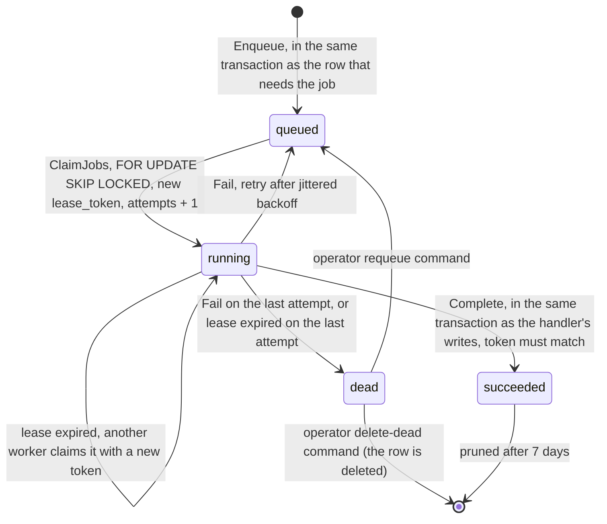
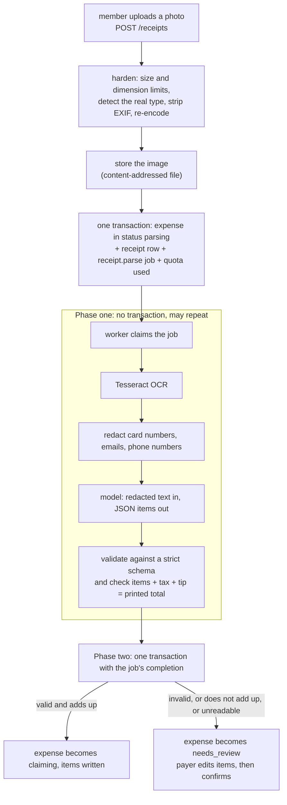
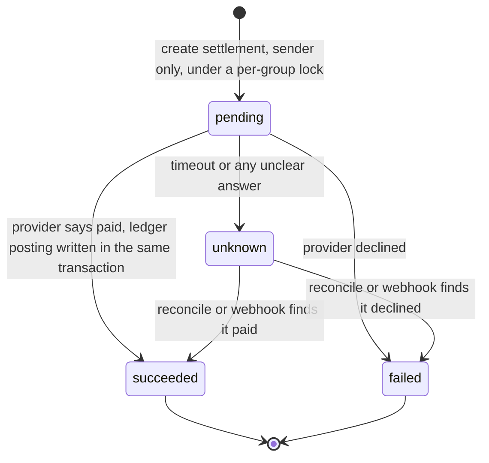
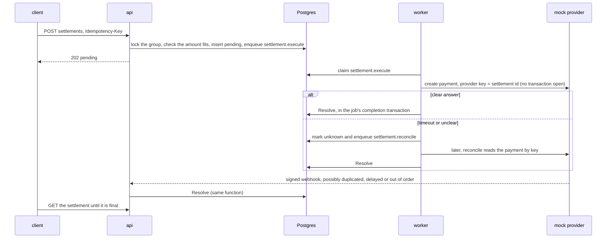

# Architecture

How the system fits together. Diagrams are [Mermaid](https://mermaid.js.org/), which GitHub renders in the browser. [EVIDENCE.md](EVIDENCE.md) says what is proven and what is not. If this file and the code disagree, the code wins.

Contents: [1 The processes](#1-the-processes) · [2 The database](#2-the-database) · [3 One request, end to end](#3-one-request-end-to-end) · [4 Money and the ledger](#4-money-and-the-ledger) · [5 The job queue](#5-the-job-queue) · [6 The receipt pipeline](#6-the-receipt-pipeline) · [7 Settlement](#7-settlement-simulated) · [8 Reading guide](#8-reading-guide-the-four-things-to-understand-first) · [9 Design choices](#9-design-choices) · [10 Known limits and future work](#10-known-limits-and-future-work)

## 1. The processes

| Process | What it does | Database role | Code |
|---|---|---|---|
| **api** | Verifies the OIDC token, checks group membership and roles, runs every user action, owns all writes a user causes, receives the payment webhook | `fifty_app` for everything done on behalf of a user; `fifty_system` for first login and the webhook (two pools) | `cmd/api`, `internal/httpapi`, `internal/auth`, `internal/groups`, `internal/expenses`, `internal/balances`, `internal/settlements`, `internal/receiptapi` |
| **worker** | Claims jobs from the `jobs` table and runs them: parse a receipt, send a settlement to the provider, reconcile an unclear one, plus housekeeping | `fifty_worker` | `cmd/worker`, `internal/worker`, `internal/queue`, `internal/receiptparse`, `internal/settlements` |
| **Postgres** | Is the database, the job queue and the lock manager. Nothing else holds state | (the server) | `migrations/` |
| **Dex** | Logs users in; its tokens are the only credential the api accepts | none | `deploy/dex/` |
| **Tesseract** | Reads the text off a receipt image (run by the worker as a child process, image on stdin) | none | `internal/ocr` |
| **mock LLM / Anthropic** | Turns redacted receipt text into JSON items. The mock answers from the synthetic receipts' ground truth; the real API is called only by the accuracy and injection evaluations and two smoke tests, never by the demo or the tests | none | `cmd/mockllm`, `internal/anthropic` |
| **mock payment provider** | Pretends to move money, with injectable faults and signed webhooks | none | `cmd/mockpay`, `internal/harness/mockpay` |

Things to remember:
- **The api and the worker never talk to each other.** They communicate only through Postgres: the api inserts a job in the same transaction as the row that needs it; the worker claims it later. That is what makes a crashed worker harmless.
- **The worker kinds** are `receipt.parse`, `settlement.execute`, `settlement.reconcile`, and the periodic `settlement.watchdog`, `receipt.sweep`, `jobs.prune`, `idempotency.cleanup`.
- **Docker runs only Postgres and Dex** (`deploy/docker-compose.yml`). The api, the worker and the mocks run on the host, and Tesseract is installed on the host. `make demo` starts all of it.
- The mobile client talks only to the api and Dex. It is typed from `api/openapi.yaml`.
- **`internal/harness/` is not product code.** It holds the support for tests, the demo and the benchmarks: the stress and settlement rigs (`stressrig`, `settlerig`), the benchmark workloads (`benchwork`, `rlsbench`), the test stack (`teststack`, `testutil`, `dbrole`) and the two mocks (`mockllm`, `mockpay`). Everything else under `internal/` is the product.

## 2. The database

### 2.1 How it is set up

- **Postgres 17** in a Docker container (`deploy/docker-compose.yml`), published on **host port 5433** (so it cannot collide with a local Postgres on 5432). User `fifty`, database `fifty`, throwaway password; the data lives in the `pgdata` volume. `make up` starts it, `make down` stops it and keeps the data, `make reset` deletes the volume (all development data).
- **Schema = 17 migrations** in `migrations/` (`00001` to `00017`), applied by **goose** (`make migrate-up`; goose is pinned in the separate module `tools/go.mod` and run through `go tool -modfile=tools/go.mod goose`). Migrations run as the owner role `fifty`. goose records progress in the `goose_db_version` table.
- **Queries are SQL files, not an ORM.** `internal/db/queries/*.sql` are compiled by **sqlc** into typed Go in `internal/db/` (committed; `make generate` regenerates it, and CI fails if the committed output is stale). sqlc reads `migrations/` as the schema, so a migration and its queries are checked against each other at generation time.
- **The driver is pgx** (`pgxpool`). Money is `bigint` minor units; there are no floats anywhere.
- **Scratch databases.** Tests, the demo and the benchmarks do not use the development database for process-level work: `settlerig.NewScratch` creates a database named `fifty_e2e_<hex>`, runs all migrations, and drops it afterwards. The shared development database is what `make test` runs against.
- **Isolation level:** READ COMMITTED everywhere, with targeted row locks (section 8.2). SERIALIZABLE is not used.

| Migration | What it adds |
|---|---|
| `00001_baseline` | a no-op, there to exercise the migration tooling before any schema existed |
| `00002_users_groups` | `users`, `groups`, `memberships` |
| `00003_join_codes_idempotency_audit` | `join_codes`, `idempotency_keys`, `audit_events` |
| `00004_app_role` | the unprivileged role `fifty_app` |
| `00005_ledger_core` | `expenses`, `expense_items`, `claims`, `ledger_transactions`, `ledger_entries`, and the ledger triggers |
| `00006_jobs` | the `jobs` table, its state CHECKs and first indexes |
| `00007_jobs_claim_index` | replaces those with one claim index, because a running job's `run_at` is now its lease expiry |
| `00008_jobs_dedupe_key` | the unique `dedupe_key` column, so a periodic job exists once |
| `00009_jobs_dead_index`, `00010_jobs_finished_index` | small partial indexes: counting dead jobs for the metrics endpoint, and finding old succeeded jobs to prune |
| `00011_settlements` | `settlements`, and the unique index allowing one ledger posting per settlement |
| `00012_jobs_settlement_index` | a partial index to find a settlement's jobs by the id in their payload |
| `00013_receipts` | `receipts`, `receipt_quota` |
| `00014_receipt_parse` | the columns the parse job fills in (outcome, reasons, token counts) and two indexes for the sweep |
| `00015_worker_system_roles` | the roles `fifty_worker` and `fifty_system` and their grants |
| `00016_row_level_security` | the policies, `app_user_id()`, `my_group_ids()`, `redeem_join_code()` |
| `00017_revoke_unused_app_privileges` | takes from `fifty_app` every privilege its code path does not use, stops new tables being granted to it automatically, and removes `TEMPORARY` from PUBLIC |

### 2.2 The four database roles

Roles are **cluster-wide** in Postgres, not per database. Never `ALTER ROLE` one without resetting it; migration 00004's Down drops `fifty_app` and fails if another database still has privileges for it.

| Role | Login | Used by | What it can do |
|---|---|---|---|
| `fifty` | yes, **superuser** | goose (migrations), tests that seed or inspect, scratch-database creation | everything; bypasses row-level security. Neither the api nor the worker ever connects as it |
| `fifty_app` | yes | the api, for a user's request | only the commands the user-request path runs, table by table (the exact list is in `test/dbinvariants/roles_test.go`): for example it can insert settlements and jobs but never update or delete them, can only read `users`, and **has no UPDATE or DELETE on `ledger_entries`, `ledger_transactions` or `audit_events`**; limited by row-level security to the caller's groups. It keeps UPDATE on `expenses` and `groups` only because `SELECT ... FOR UPDATE` needs it |
| `fifty_system` | yes | the api, for first login and the payment webhook | create users, read groups, update settlements, insert ledger rows and audit events: only what those two paths need |
| `fifty_worker` | yes | the worker | the `jobs` table in full, plus the narrow reads and writes each job handler needs |

The exact privilege letters per role per table are pinned by `test/dbinvariants/roles_test.go`: a new table fails that test until someone classifies it, and a widened grant shows as a diff.

### 2.3 The tables

`jobs` has no foreign keys on purpose: a job's payload names an id (a settlement, a receipt) and the handler looks it up. `goose_db_version` (migration bookkeeping) is the 16th table and is not drawn.

| Table | Holds |
|---|---|
| `users` | one row per person, keyed by (issuer, subject) from the OIDC token; created on first valid request |
| `groups` | a group of friends with one currency |
| `memberships` | who is in which group, and their role (`owner` or `member`) |
| `join_codes` | invite codes, stored as a hash, with use limit, expiry and revocation |
| `expenses` | one shared bill: payer, tax, tip, status, `version` |
| `expense_items` | the claimable units of an expense (a quantity of 3 is stored as 3 items) |
| `claims` | which member claimed which item (unique per item and member) |
| `receipts` | the uploaded photo's metadata and what the parse job found (counts, token usage, reasons; never the text) |
| `receipt_quota` | uploads per user per day, which caps LLM cost |
| `ledger_transactions` | one posting: an expense finalize, a void, or a settlement |
| `ledger_entries` | the signed amounts per member that make up a posting; they sum to zero |
| `settlements` | a payment from one member to another, and where it is in its life |
| `idempotency_keys` | the stored response for every retried-safe request, kept 24 hours |
| `audit_events` | who did what in which group (finalize, void, settle, join, conflicts) |
| `jobs` | the work queue |

### 2.4 What the database enforces itself

Application code can have bugs; these are the rules that hold even when it does. Each is tested by sending the forbidden SQL directly (`test/dbinvariants`, `test/rls`).

- **No cross-group rows.** Foreign keys are *composite*: a claim points at `(expense_id, group_id)` and `(group_id, member_id)`, a ledger entry at `(transaction_id, group_id)` and a membership, an expense's payer at a membership of the same group. A row that mixes groups cannot be inserted.
- **The ledger is append-only.** `fifty_app` has no UPDATE/DELETE on it, and triggers (`ledger_*_append_only`, `ledger_*_no_truncate`) refuse them even from the table owner.
- **Every posting sums to zero.** A deferred constraint trigger (`ledger_entries_zero_sum`) checks it at COMMIT, so entries can be inserted one by one but the transaction cannot commit unbalanced. A second trigger (`ledger_entries_same_tx`) lets entries be added only by the transaction that created their posting.
- **One posting per cause.** Partial unique indexes: one `expense` posting per expense, one `void` per expense, one `settlement` posting per settlement.
- **Row shapes make states coherent** (CHECK constraints): an expense is finalized or void exactly when `finalized_at` / `voided_at` is set; a settlement is `succeeded` exactly when it links a ledger posting, `failed` exactly when it has a failure code, and has a `resolved_at` exactly when it is final; a job is `running` exactly when it has a lease token and expiry; a ledger transaction's `kind` decides which of `expense_id`, `reverses_id` and `settlement_id` must be present.
- **Row-level security (RLS)** on 14 tables, forced: the api's role can see and change only rows of groups the caller belongs to, *even for a query that forgot its membership check*. `jobs` and `goose_db_version` are the documented exceptions. See 2.5.
- **Joining a group is a database function.** `redeem_join_code(hash)` (SECURITY DEFINER) locks the code row, checks it is usable, adds the caller (taken from the session setting, not from an argument) and spends one use; `fifty_app` has no way to insert a member row by raw SQL.

### 2.5 How row-level security gets the caller

- `internal/dbscope` is the only way a handler reaches the database. It hands out a transaction (`Begin`) or a one-statement read (`Reader`, a short read-only transaction), and it has no way to hand out the raw pool.
- `app_user_id()` reads the setting; `my_group_ids()` returns the caller's group ids (SECURITY DEFINER, because a policy on `memberships` that selected from `memberships` would recurse). The policies call it once per statement, not per row.
- **What this does not do:** the setting is self-asserted, so code running as `fifty_app` could set it to anyone; the worker, the webhook and first login run as other roles and see everything their grants allow; roles *inside* a group (payer-only finalize, owner-or-payer void) stay in the application. RLS is a second layer behind the application's own checks, not a replacement ([EVIDENCE.md](EVIDENCE.md) claims 10 and 15 have the exact limits and the measured cost).

## 3. One request, end to end

What happens for a typical write, `POST .../finalize`:

Layers a request passes, in order: HTTP size limits and rate limits, **authentication** (`internal/auth`: OIDC verification; users are keyed by issuer and subject), **authorization in the handler** (membership of the group, then the role the action needs; a non-member gets 404 so ids are not revealed), **idempotency** (`internal/idempotency`), the **transaction through `dbscope`** (RLS identity), the **row locks** that order concurrent actions, and the **constraints** that refuse anything impossible. The BOLA test suite (`test/bola`) tries every group-scoped operation as an outsider, a non-owner and anonymous.

## 4. Money and the ledger

Everything is an `int64` of minor units (cents), one currency per group (CAD or USD).

- **The ledger is a set of signed entries.** A member's balance in a group is `SUM(amount_minor)` over their entries; positive means the group owes them. All balances in a group always sum to zero, because every posting does.
- **Three kinds of posting** (`ledger_transactions.kind`):
  - `expense` on finalize: the payer is credited what the others owe, each other claimant debited their share.
  - `void`: the exact negation of the finalize posting (`reverses_id` points at it). Nothing is ever edited or deleted.
  - `settlement` on a successful payment: the sender's balance rises toward zero, the payee's falls.
- **Shares** come from `internal/allocator`: each item is split evenly among its claimants, tax and tip are prorated by each member's claimed subtotal, and leftover cents go to the largest remainder with ties broken by member id, so the shares always add up exactly. `internal/ledger` turns shares into entries.
- **Suggested transfers** (`internal/ledger/transfers.go`) are computed at read time by a greedy pass over balances, limited to what can be settled right now: net of the money open (pending or unknown) settlements have already reserved, by the same rule create-settlement applies. They reduce the number of payments but do not minimize it, and nothing is posted by suggesting.

## 5. The job queue

A single `jobs` table (migration 00006), under 600 lines of Go in `internal/queue`, and the worker runtime in `internal/worker`. It exists to run slow, failure-prone work (OCR and the model, the payment provider) outside the request, and to survive a worker dying in the middle.

How the pieces fit:
- **Claim.** One statement picks eligible rows (queued and due, or running with an expired lease; while running, `run_at` *is* the lease expiry), takes `FOR UPDATE SKIP LOCKED` so concurrent workers pass over each other's rows instead of waiting, stamps a fresh `lease_token` and expiry from the *database* clock, and counts the attempt.
- **Heartbeat.** The worker extends its lease every third of the lease period, but only if the token still matches. If another worker took the job over, the heartbeat finds out and cancels the handler.
- **Fencing.** Every later write by a worker (heartbeat, complete, fail) is conditional on its lease token. A worker that was slow or partitioned and lost its lease matches no row and changes nothing, however late it arrives.
- **Two-phase handlers.** A handler returns a `Commit` function. Phase one (OCR, the model call, the provider call) runs with no transaction open and may run more than once. Phase two runs inside the transaction that also marks the job succeeded: the handler's database writes and the job's completion commit together or not at all. So effects in Postgres are exactly-once, while calls to the model or the provider are at-least-once (the provider call is keyed by the settlement id so a repeat charges nothing).
- **Retries.** Jittered exponential backoff (2 s base, 5 minute cap: placeholder values), a service's `retry-after` is honored up to a cap, and the last failed attempt goes to `dead`, which an operator can requeue.
- **No push, only polling.** Workers poll (default every second). `LISTEN/NOTIFY` was measured and not built.

Code: `internal/queue` (`queue.go` enqueue, `claim.go`, `lease.go` heartbeat/complete/fail, `backoff.go`), `internal/db/queries/jobs.sql`, `internal/worker/worker.go` (the poll loop, `runJob`, `heartbeat`).

## 6. The receipt pipeline

- **The model is untrusted.** It has no tools; its output must match an exact schema; whether a human must look is decided by arithmetic only (the self-reported confidence is not used). The worst case of a bad or malicious receipt is a wrong parse the payer reviews. A parse that is wrong *and* adds up is not caught: measured on synthetic receipts with Claude Haiku 5.5 ([EVIDENCE.md](EVIDENCE.md) claim 8), the arithmetic check caught 43 of 46 wrong-amount receipts but none of 8 wrong-quantity ones, and the three amount errors that got through were the model filling an unreadable price so the sum matched.
- **There is no failed status.** A receipt that cannot be read ends in `needs_review` with no items, and the payer types it in. A sweep job moves expenses whose job died to `needs_review`, so nothing stays in `parsing` forever.
- **Personal data:** card numbers, emails and phone numbers are replaced by placeholders before text leaves the system; names and addresses are not touched. Logs and the database never hold the receipt text.
- Code: `internal/receiptapi` (upload), `internal/receipts` (hardening, redaction, validation, the review decision), `internal/receiptparse` (the job and the sweep), `internal/ocr`, `internal/anthropic`, `internal/objstore`.

## 7. Settlement (simulated)

No real money moves: the "provider" is `cmd/mockpay`.

**`settlements.Resolve` is the only code that moves a settlement's status or writes a settlement posting.** The execute job, the reconcile job and the webhook all call it. It locks the settlement row `FOR UPDATE`, asks the pure state machine (`Transition`) what to do with the finding (apply it, ignore a repeat, or record a contradiction of a final state as `settlement.conflict`), and on success writes the ledger posting and marks the settlement succeeded in the same transaction. A unique index on the posting is the database's backstop. A watchdog job re-enqueues settlements stuck in `pending`.

The amount a member may settle is bounded by `min(what they owe the group, what the group owes the payee)`, each reduced by the open settlements already reserving that money (the ledger has net balances, not pairwise debts). Code: `internal/settlements` (`settlements.go` Resolve and the state machine, `execute.go`, `reconcile.go`, `watchdog.go`, `webhook.go`, `handler.go`), `internal/payclient`.

## 8. Reading guide: the four things to understand first

For each: the short answer, where to read, and the questions a reader tends to ask. Read the file comments first; most files open with the reasoning.

### 8.1 The queue

**Short answer.** A Postgres table is the queue. Enqueueing is an INSERT in the same transaction as the business row, so there is no dual write. Workers claim with one `FOR UPDATE SKIP LOCKED` statement that stamps a fresh lease token. Every later write is conditional on that token (the fence), so a worker that lost its lease cannot overwrite the new attempt. Handler effects and job completion commit in one transaction.

**Read, in order:** `migrations/00006_jobs.sql` (the table and its CHECKs) → `internal/db/queries/jobs.sql` (`ClaimJobs`, then the three token-conditional writes) → `internal/queue/claim.go`, `lease.go` → `internal/worker/worker.go` (`runJob`, `runHandler`, `heartbeat`).

**Common questions:**
- *What if a worker dies mid-job?* Its lease expires, the job becomes claimable, another worker takes it with a new token. Measured: [EVIDENCE.md](EVIDENCE.md) claim 4.
- *What stops the old worker from finishing late?* The token: its completion matches no row.
- *Is it exactly-once?* For writes inside the handler's Postgres transaction, yes. For the model and provider calls, no: at-least-once, which is why the provider call is keyed.
- *Why not SQS, Kafka or River?* Transactional enqueue with no extra infrastructure, and the mechanism is the point. The cost: Postgres will not carry very high job rates, and polling adds latency (`LISTEN/NOTIFY` measured, not built).
- *Why `SKIP LOCKED`?* Claimers never wait on each other and never get the same row.

### 8.2 Locking

**Short answer.** READ COMMITTED plus one row lock per expense, chosen by strength. Claims take `FOR SHARE` on the expense row (many claimers at once). Item edits and confirm take `FOR NO KEY UPDATE`. Finalize and void take `FOR UPDATE`. A `FOR UPDATE` waits for every in-flight claim and blocks new ones; a claim that arrives during a finalize waits, then sees `finalized` and gets 409. So finalize always reads a stable set of claims. Creating a settlement serializes on the group row (`FOR NO KEY UPDATE`, because `FOR UPDATE` would block foreign-key inserts).

| Does a request (column) wait for a lock already held (row)? | claim (`FOR SHARE`) | edit/confirm (`FOR NO KEY UPDATE`) | finalize/void (`FOR UPDATE`) |
|---|---|---|---|
| held by a claim | no | yes | yes |
| held by an edit or confirm | yes | yes | yes |
| held by a finalize or void | yes | yes | yes |

**Read:** `internal/db/queries/expenses.sql` (the `Lock...` queries, each comment says which locks it conflicts with) → `internal/expenses/claims.go` (`setClaim`), `finalize.go` (`doFinalize`), `void.go`, `edit.go` → `internal/controls` (the negative-control seams) → [EVIDENCE.md](EVIDENCE.md) claims 1 and 2.

**Common questions:**
- *Why not SERIALIZABLE?* Targeted locks make the conflict explicit and cheap, and claimers must not block each other.
- *Why does an edit not bump the version on a claim?* A claim must not make the payer's pending edit stale; an edit instead deletes the claims it invalidates.
- *How do you know the locks matter?* The negative controls: with one lock switched off (only in the `unsafe_controls` build) the stress run shows the ledger disagreeing with the claims. Some locks showed no violation because another layer caught it, and EVIDENCE.md says so.
- *What stops two edits made from one version?* The version compare under the lock, then a conditional update on the version read under the lock.

### 8.3 Idempotency

**Short answer.** The client sends `Idempotency-Key`. The first request claims the key by inserting a row in the same transaction as the operation; the response is stored in that row before commit. A retry with the same key and the same request replays the stored response; a different request under the same key is 422. A concurrent duplicate blocks on the primary-key index until the first transaction finishes, then replays. Effects, response and key commit or roll back together, so there is no "in progress" state to get stuck on.

**Read:** the package comment and `Do` in `internal/idempotency/idempotency.go` → how a handler builds its fingerprint (`internal/expenses/finalize.go`, `finalize`) → `internal/expenses/*_test.go` (replay, reuse, 10 concurrent duplicates).

**Common questions:**
- *What is stored?* Every response below 500, including 404s and 409s (so a retry sees the original outcome). A 5xx rolls everything back and is not stored.
- *What if the first request crashes?* The transaction rolls back, the key row with it, and a retry runs fresh.
- *Why a fingerprint?* So the same key with a different request is a client bug, not a replay.
- *Scope and lifetime?* Per user, 24 hours, cleaned hourly by a periodic job.

### 8.4 The ledger

**Short answer.** An append-only list of signed entries grouped into postings; a balance is a SUM; every posting sums to zero, and the database refuses a posting that does not (a deferred constraint at COMMIT). Finalize posts the shares; a void posts the exact negation; a successful settlement posts a transfer. Nothing is ever updated or deleted, not even by the table owner (a superuser could still disable the triggers, so this protects against application bugs and a compromised app, not against the database administrator).

**Read:** `migrations/00005_ledger_core.sql` (tables, triggers, comments) → `internal/allocator` (the share math) → `internal/ledger/ledger.go` → `internal/expenses/finalize.go` (`doFinalize`) and `void.go` → `internal/settlements/settlements.go` (`Resolve`) → `test/dbinvariants/ledger_test.go`.

**Common questions:**
- *How do you split a bill exactly?* Largest-remainder allocation: floor each share, give the leftover cents to the largest fractional remainders, ties by member id. Property-tested: the shares always sum to the total.
- *How does a void work with settlements already made?* It appends a reversing posting; a pair can end up overpaid and a balance can change sign, which is correct bookkeeping.
- *How is it checked under load?* The stress run recomputes every invariant from the tables, never from API answers ([EVIDENCE.md](EVIDENCE.md) claim 1).
- *Is this a payments ledger?* No. It records IOUs between friends; settlement is simulated.

## 9. Design choices

Each is a choice with its cost. The reasoning for the first four is in the reading guide above.

- **A Postgres queue, not Kafka, SQS or River.** Enqueueing is a plain INSERT in the same transaction as the business row, with no extra infrastructure. The cost: it will not carry very high job rates, and workers poll.
- **READ COMMITTED with targeted row locks, not SERIALIZABLE.** Claimers must not block each other, and finalize must see a stable set of claims. The cost: each lock strength has to be chosen and tested (section 8.2).
- **Idempotency inside the transaction.** The key row, the operation's writes and the stored response commit or roll back together, so there is no "in progress" state to get stuck on.
- **One writer for settlement state.** `settlements.Resolve` is the only code that moves a settlement forward or posts it; the execute job, the reconcile job and the webhook all call it.
- **The database enforces the ledger rules itself.** Zero-sum postings, an append-only ledger and no cross-group rows are constraints and triggers, so a bug in the application cannot corrupt the ledger. The cost: rules in triggers are harder to evolve than rules in code.
- **Authorization in layers.** The handler checks membership and role (a non-member gets the same 404 as a missing id, so ids are not revealed); row-level security limits the user-request role to the caller's groups even for a query that forgot its own check; and each role holds only the privileges its code path uses. Row-level security is a second layer, not containment (section 2.5).
- **Money is `int64` minor units, one currency per group** (CAD or USD), with no floats anywhere. Shares are split by largest remainder, so they always add up exactly.
- **SQL in files with sqlc and pgx, no ORM.** The queries are checked against the migrations when the Go is generated; the generated code is committed and CI fails if it is stale.
- **REST/JSON with an OpenAPI spec**, from which the mobile client is typed. A drift check fails if they disagree.
- **The model's answer is untrusted.** It has no tools, its answer must match a strict schema, arithmetic alone decides whether a person looks (there is no "confidence" field to be fooled by), and a person confirms what was read. Card numbers, emails and phone numbers are replaced before text leaves the system. Error messages and logs never quote the service's reply or the receipt; tests plant values and search the logs.
- **Every protection that matters can be switched off, in a build that is never shipped.** The `unsafe_controls` build tag (`internal/controls`) lets the stress run disable one lock or check at a time, so a clean run can be told apart from a run that could not have failed. The production binaries have no flag or environment variable that disables a protection, and a test checks that the control code is absent from their symbols.
- **Mocks behind interfaces.** The language model and the payment provider are mockable, and tests verify tokens with the unmodified verifier against an in-process fake issuer, so there is no auth-bypass path. Tests and the demo use the mocks; the real model API is called only by the accuracy and injection evaluations.
- **Login.** Auth Code + PKCE against a self-hosted Dex with static synthetic users. Dex keeps its state in Postgres, because Dex 2.46.0 and 2.46.1 deadlock on a token refresh with in-memory or SQLite storage. The OIDC `iss` must match from every place that sees it, which is why only the iOS Simulator (which shares `localhost` with the host) is supported.
- **Smaller baseline.** Join codes are hashed at rest, expiring, revocable and rate-limited. Requests are size-limited and rate-limited per user, and receipt uploads have a daily quota that caps model cost. Every query is parameterized.

## 10. Known limits and future work

### Limits (accepted, so they are not mistaken for bugs)

- **One host.** Receipt images are a directory behind `objstore.Store`, shared by the api and the worker: no delete and no sweep of orphan blobs, and upload drops the EXIF orientation, so a client must send upright pixels (the mobile client does). The rate limiter is per api process. The metrics endpoint is unauthenticated and off by default.
- **Placeholder constants, not tuned:** 4 parse attempts, the sweep intervals, the 6,000-character OCR cap, OCR and model timeouts (30 s and 60 s), the upload rate limit (burst 5, one per 10 s) and daily quota (20), Tesseract page segmentation mode 6, the reconcile schedule, and the retry backoff (base 2 s, cap 5 min).
- **Settlements** cannot be cancelled while `pending` or `unknown`; one stuck in `unknown` past the reconcile deadline needs an operator.
- **Balances** are computed per request from the group's ledger entries. A cached running balance would need the zero-sum and derived-by-SUM invariants re-proved.
- **Quantity digits lost by OCR** are invisible to the arithmetic check (8 of the 11 silent errors in [EVIDENCE.md](EVIDENCE.md) claim 8). A person fixing units is the expected path.
- **Dead jobs** are the dead-letter record and are never deleted unattended, so an ignored dead-letter queue grows. Alert on the `fifty_queue_jobs{state="dead"}` gauge; clear with `worker delete-dead` (needs a filter, has `--dry-run`) or retry with `worker requeue`.
- **Sign-out cannot revoke a refresh token** (Dex has no revocation endpoint here); it only deletes the token from the device.
- **A list longer than 5,000 items** shows only 5,000 in the app.
- **A claim whose client cancels mid-flight** (a worker shutting down) can lease jobs that nobody runs; they are retried after the lease expires, with the attempt counted. The same outcome as a crash.
- **Roles are cluster-wide in Postgres.** The Down migrations of `00004` and `00015` drop them and fail if another database in the cluster still has privileges for them, and `ALTER ROLE fifty_app` affects every database.
- **`LISTEN/NOTIFY`** to wake workers was measured and not built; the polling cost is in the low-rate latency figures (EVIDENCE claim 3).
- **The `unsafe_controls` build** must never be used for a release binary. `make test-unsafe` runs in CI; `make test-controls` (about 6 minutes, real processes) does not.

### Future work (not built, not claimed)

- **Re-record what predates row-level security.** The negative controls (about 46 minutes), the settlement benchmark (about 20) and the queue retry scenario (about 5) were recorded before the policies and the separate worker roles. Today they are re-checked as pass/fail only (`make test-controls`, `make test-e2e`). A re-recording would remove the "recorded before" caveats from EVIDENCE claims 2, 5 and 6.
- **The identity seam.** Each read runs as `BEGIN`, a `set_config`, the statement and `COMMIT`, which cost about half the throughput of a local mixed workload (EVIDENCE claim 10). The idea is to send a read as one pipelined batch (`set_config` for the identity, then the statement; the implicit transaction ends at the batch's sync), wrapping the rows so sqlc's `defer rows.Close()` ends it. Risk: it changes the code every read goes through, so it needs `internal/dbscope` and `test/rls` coverage (the identity must not outlive the statement; the connection must be released on every path; writes must be refused), the whole suite and a stress run. Re-record `bench/rls` and keep both recordings.
- **A third prompt.** Prompt v2's rule against back-solving also made the model leave out the required total (EVIDENCE claim 8). A reworded rule would be a v3 and needs receipts nobody has looked at (references 5201-5250, about 8 US cents). Turning the model's thinking off or lowering its effort might cut latency and cost; it would need a 250-call recording to show accuracy is unharmed.
- **The settlement benchmark's unexplained replays.** The mock provider saw 21 to 36 replayed create calls per run in two mixes although execute never resends. A likely cause is Go's `net/http` transparently retrying a keyed request when the provider aborts a reused connection. Unverified, and harmless to correctness, but the create-call counts include them.
- **The app.** An automated UI test (Maestro or Detox), creating an expense without a receipt, token revocation on sign-out, Android and the camera.
- **Beyond a laptop.** A real payment provider; more than one api instance (the rate limiter would move out of process memory); an object store (MinIO or S3) behind `internal/objstore.Store`; a container image for the api and worker.
- **Cut from scope:** Kubernetes, Terraform and autoscaling; multi-currency and multi-payer expenses; envelope encryption of receipts; push notifications; vision-model extraction.
